# 🛡️ AI-Powered Cybersecurity Threat Detection System

> A Python machine-learning and Streamlit dashboard project that simulates network activity, classifies suspicious events, scores anomalies, and presents investigation-ready alerts. Built for local learning and portfolio demonstration using generated synthetic data—not live network traffic.

---

## 👨‍💻 Author

**Adarsh Srivastav**<br>
Computer Science and Engineering (CSE) Student<br>
Artificial Intelligence | Cybersecurity | Python | Machine Learning

---

## 📌 Project Overview

The **AI-Powered Cybersecurity Threat Detection System** is an educational security analytics project. It.  demonstrates how a detection workflow can turn network-like event records into predictions, anomaly scores, and alerts for analyst review.

The project generates a reproducible synthetic dataset containing normal events and simulated attack categories:

- Denial of Service (DoS)
- Brute force
- Port scan
- Malware-like activity

A **Random Forest classifier** predicts whether an event is normal or an attack. An **Isolation Forest** provides a separate anomaly score. A local **Streamlit dashboard** displays the simulated traffic, alert queue, evaluation metrics, and model charts.

The pipeline can be run from the terminal, and the dashboard can be explored in a browser. It is not connected to a live network, SIEM, or corporate security system, and its synthetic-data results should not be treated as real-world model performance.

---

## 🎯 Objectives

- Create a repeatable synthetic network-event dataset.
- Represent normal traffic and several attack-like categories.
- Clean and transform event data into model features.
- Train a supervised classifier and an unsupervised anomaly detector.
- Evaluate classification performance on a held-out test split.
- Generate a concise, filterable alert view.
- Visualize traffic categories, feature importance, and anomaly scores.
- Provide a local dashboard that is easy to run and demonstrate.
- Add automated tests for core data and model behavior.
- Document limitations and make the work reproducible for GitHub reviewers.

---

## ✨ Key Features

- Deterministic synthetic dataset generation with a fixed random seed
- 5,000 sample network-like events in the included CSV
- Normal, DoS, brute-force, port-scan, and malware-like categories
- Network and behavior features: protocol, bytes, packet size, duration, login failures, and request frequency
- Random Forest binary threat classification
- Isolation Forest anomaly scoring
- Accuracy, precision, recall, F1 score, and confusion matrix
- Severity-labelled alert summary with model confidence
- Interactive Streamlit dashboard with four views:
  - Overview
  - Alert queue
  - Traffic data
  - Model performance
- Dashboard filters for attack category and alert severity
- Visual outputs for category counts, alert activity, feature importance, and anomaly distribution
- Pytest coverage for generation, preprocessing, splitting, training,     alerting, and model serialization
- No GPU or real network access required

---

## 🏗️ System Architecture

```text
                AI-POWERED CYBERSECURITY THREAT DETECTION

 ┌────────────────────────┐
 │ Synthetic Event Dataset│
 │ CSV / Generator        │
 └────────────┬───────────┘
              │
              ▼
 ┌────────────────────────┐
 │ Data Preparation       │
 │ Missing values,        │
 │ excluded identifiers,  │
 │ one-hot encoding       │
 └────────────┬───────────┘
              │
              ▼
 ┌────────────────────────────────────┐
 │ Model Training                     │
 │ Random Forest  │  Isolation Forest │
 └────────┬───────┴──────────┬────────┘
          │                  │
          ▼                  ▼
 ┌──────────────────┐  ┌────────────────┐
 │ Threat prediction│  │ Anomaly score  │
 └─────────┬────────┘  └───────┬────────┘
           └──────────┬────────┘
                      ▼
          ┌────────────────────────┐
          │ Alert scoring & review │
          └───────────┬────────────┘
                      │
          ┌───────────┴───────────────┐
          ▼                           ▼
 ┌────────────────────┐     ┌────────────────────┐
 │ Terminal reports   │     │ Streamlit dashboard│
 │ CSV/PNG outputs    │     │ Local investigation│
 └────────────────────┘     └────────────────────┘
```

---

## 🔄 Detection Workflow

```text
Generate or load event data
           ↓
Validate fields and prepare labels
           ↓
Drop timestamp/IP identifiers from model features
           ↓
Fill missing values and encode categorical features
           ↓
Create stratified train/test split
           ↓
Train Random Forest and Isolation Forest
           ↓
Predict threat labels and calculate anomaly scores
           ↓
Evaluate classification and build alert summaries
           ↓
Display results in terminal, charts, and dashboard
```

### Event classification

The classifier maps the dataset labels as follows:

```text
Normal → 0
Attack → 1
```

The `attack_type` and `severity` columns describe generated events, but are excluded from classifier features. Timestamp and IP address fields are also excluded from model features.

### Alert generation

An event is included in the alert summary when the classifier predicts an attack or the Isolation Forest score passes the configured anomaly threshold. The summary assigns a display severity from the classifier probability and anomaly score. This is a demonstration rule, not an incident-response policy.

---

## 🧪 Synthetic Dataset

The default dataset is [`data/cyber_threat_dataset.csv`](data/cyber_threat_dataset.csv), generated by [`src/data_generation.py`](src/data_generation.py).

| Field | Description |
|---|---|
| `timestamp` | Simulated event time |
| `source_ip` | Generated private-range source address |
| `destination_ip` | Generated private-range destination address |
| `protocol` | Simulated protocol category |
| `connection_duration_seconds` | Connection duration |
| `bytes_sent` | Bytes sent by the source |
| `bytes_received` | Bytes received by the source |
| `failed_logins` | Simulated failed login count |
| `request_frequency_per_min` | Simulated requests per minute |
| `packet_size_bytes` | Simulated packet size |
| `ports_touched` | Simulated number of contacted ports |
| `blocked` | Generated blocked-activity indicator |
| `attack_type` | Normal or simulated attack category |
| `severity` | Generated descriptive severity |
| `label` | Binary-classification target: `Normal` or `Attack` |

> **Data note:** These rows are generated for software testing and visualization. They are not captured packet data, validated attack traces, or a substitute for a public benchmark dataset such as CICIDS or UNSW-NB15.

---

## 🤖 Models & Evaluation

### Random Forest classifier

The supervised model predicts the binary `label` from prepared numerical and one-hot-encoded event features. The project uses a stratified 75/25 train/test split so both labels are represented in training and evaluation.

### Isolation Forest

The unsupervised model produces anomaly scores from training features. It is used as a complementary signal in the demonstration alert logic, not as a calibrated production risk score.

### Metrics

- **Accuracy:** fraction of predictions that are correct
- **Precision:** fraction of predicted attacks that are labelled attacks
- **Recall:** fraction of labelled attacks found by the classifier
- **F1 score:** harmonic mean of precision and recall
- **Confusion matrix:** counts of correct and incorrect class predictions

The included synthetic dataset currently produces a 1,250-event test split with 970 normal and 280 attack-labelled events. Because generated features and labels are strongly separable by construction, very high scores are expected and do **not** imply production readiness.

---

## 💻 Software & Tools

- **Language:** Python 3.10+
- **Data processing:** Pandas, NumPy
- **Machine learning:** Scikit-learn
- **Dashboard:** Streamlit
- **Visualizations:** Streamlit native charts, Matplotlib, Seaborn
- **Model serialization:** Joblib
- **Automated tests:** Pytest
- **Development:** Visual Studio Code or another Python editor
- **Version control:** Git and GitHub

GPU acceleration is not required.

---

## 📁 Project Structure

```text
AI-Powered-Cybersecurity-Threat-Detection/
│
├── .streamlit/
│   └── config.toml
├── data/
│   ├── cyber_threat_dataset.csv
│   └── README.md
├── docs/
│   ├── architecture.md
│   └── github-proof-guide.md
├── images/
├── models/
├── notebooks/
├── outputs/
├── screenshots/
│   ├── 01_dashboard_overview.png
│   ├── 02_traffic_charts.png
│   ├── 03_high_confidence_alerts.png
│   ├── 04_alert_queue.png
│   ├── 05_filtered_alerts.png
│   ├── 06_simulated_traffic.png
│   ├── 07_model_evaluation.png
│   ├── 08_top_model_signals.png
│   ├── 09_anomaly_score_detection.png
│   ├── 10_project_ui.png
│   ├── 11_test_suite_passed.png
│   └── 12_focused_model_tests_passed.png
├── src/
│   ├── __init__.py
│   ├── alerting.py
│   ├── data_generation.py
│   ├── modeling.py
│   ├── preprocessing.py
│   └── visualization.py
├── tests/
│   └── test_pipeline.py
├── .gitignore
├── app.py
├── main.py
├── README.md
└── requirements.txt
```

### Main modules

| File | Responsibility |
|---|---|
| `main.py` | Runs dataset preparation, model training, evaluation, alerts, and saved plots |
| `app.py` | Runs the interactive local Streamlit dashboard |
| `src/data_generation.py` | Generates reproducible synthetic event data |
| `src/preprocessing.py` | Loads data, cleans missing values, encodes features, and splits data |
| `src/modeling.py` | Trains and evaluates both machine-learning models |
| `src/alerting.py` | Builds a short alert summary from predictions and anomaly scores |
| `src/visualization.py` | Saves confusion matrix, feature-importance, and anomaly plots |
| `tests/test_pipeline.py` | Tests core project behavior |

---

## ⚙️ Installation

### Requirements

- Python 3.10 or later
- `pip`
- Internet access for the initial package installation

### Windows PowerShell

```powershell
git clone https://github.com/adarshsrivastav23905/AI-Powered-Cybersecurity-Threat-Detection.git
cd AI-Powered-Cybersecurity-Threat-Detection
python -m venv .venv
.\.venv\Scripts\Activate.ps1
python -m pip install --upgrade pip
pip install -r requirements.txt
```

If PowerShell blocks virtual-environment activation, use Command Prompt instead:

```bat
.venv\Scripts\activate.bat
```

### macOS / Linux

```bash
git clone https://github.com/adarshsrivastav23905/AI-Powered-Cybersecurity-Threat-Detection.git
cd AI-Powered-Cybersecurity-Threat-Detection
python3 -m venv .venv
source .venv/bin/activate
python -m pip install --upgrade pip
pip install -r requirements.txt
```

---

## ▶️ How to Run

Run commands from the project root with the virtual environment activated.

### Run the machine-learning pipeline

Use the included dataset:

```bash
python main.py
```

Generate a fresh deterministic synthetic dataset before training:

```bash
python main.py --generate-data
```

The pipeline prints evaluation metrics and a top-alert summary. It saves visualizations in `outputs/`.

### Launch the interactive dashboard

```bash
streamlit run app.py
```

Open the local URL printed by Streamlit (normally `http://localhost:8501`). The dashboard provides:

- **Overview:** dataset and evaluation KPIs, event category chart, hourly alert activity, and high-confidence alerts
- **Alert queue:** searchable-by-filter display of model/anomaly alerts
- **Traffic data:** generated event records
- **Model performance:** evaluation metrics, confusion matrix, top model signals, and anomaly distribution

Use the sidebar to filter attack categories and severities, toggle flagged-only events, or retrain the models.

### Run automated tests

```bash
python -m pytest -v
```

Run only the focused training and alert tests:

```bash
python -m pytest -v tests/test_pipeline.py::test_training_returns_bounded_metrics_and_predictions tests/test_pipeline.py::test_alerts_and_saved_model_predictions
```

---

## 🧪 Testing

The automated test suite validates the core software pipeline without connecting to external services.

| Test | Validation |
|---|---|
| `test_generator_writes_expected_labeled_dataset` | Generated CSV, expected fields, row count, and both labels |
| `test_preprocessing_encodes_features_without_target_leakage` | Encoded features, binary labels, no missing values, and excluded targets/identifiers |
| `test_data_split_is_stratified_and_covers_all_rows` | Expected split size and representation of both labels |
| `test_training_returns_bounded_metrics_and_predictions` | Model outputs, confusion matrix, anomaly scores, and metrics within valid bounds |
| `test_alerts_and_saved_model_predictions` | Alert structure/severities and consistent model save/load predictions |

Latest verified result:

```text
5 passed
```

Test proof screenshots are stored in `screenshots/11_test_suite_passed.png` and `screenshots/12_focused_model_tests_passed.png`.

---

## 📊 Results

On the included 5,000-row synthetic dataset, the current fixed train/test split reports:

```text
Events in dataset: 5,000
Test events:       1,250
Actual normal:       970
Actual attacks:      280
Accuracy:          100.0%
Precision:         100.0%
Recall:            100.0%
F1 score:          100.0%
```

This score reflects the deliberately separable synthetic data. Real network data is noisy, imbalanced, time-dependent, and affected by changing adversary behavior. Evaluate future models on realistic, independent datasets and report false positives, false negatives, class balance, and data provenance.

---

## 📸 Project Screenshots

The captures below are local application and test evidence. They use generated data and are not screenshots from a live SOC.

### Dashboard overview

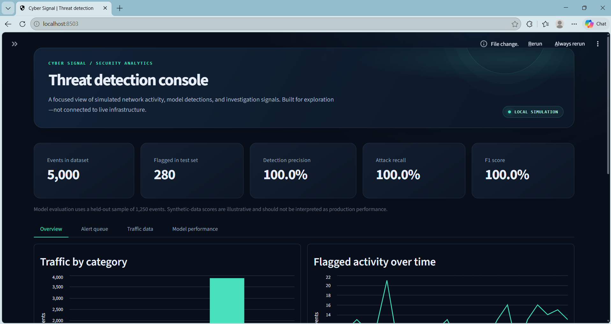

### Traffic category and alert activity

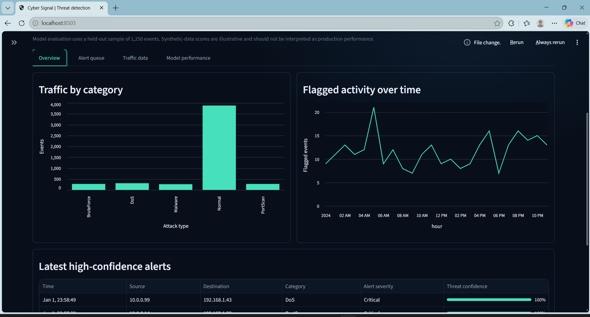

### Latest high-confidence alerts

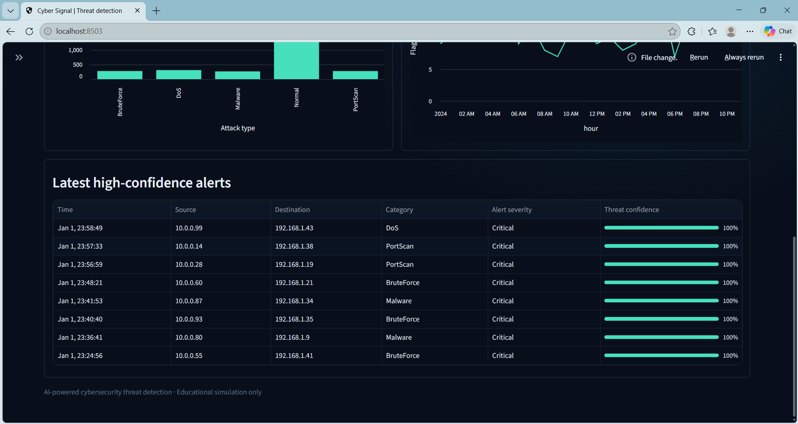

### Alert queue

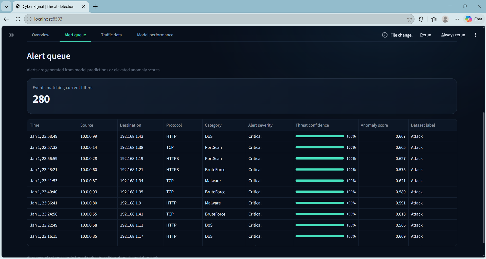

### Filtered alerts

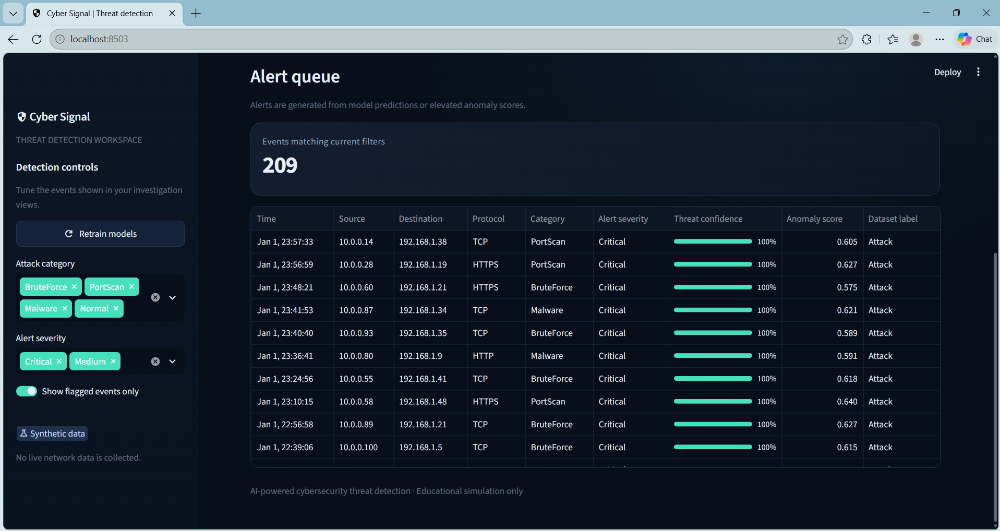

### Synthetic network event data

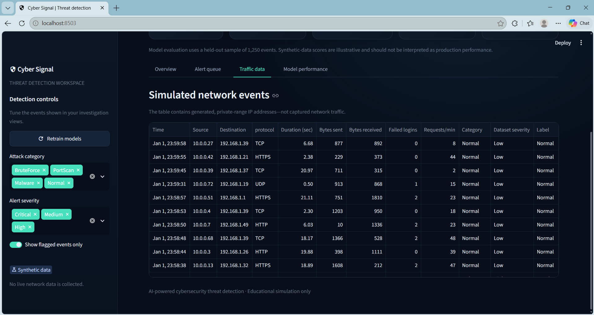

### Model evaluation and confusion matrix

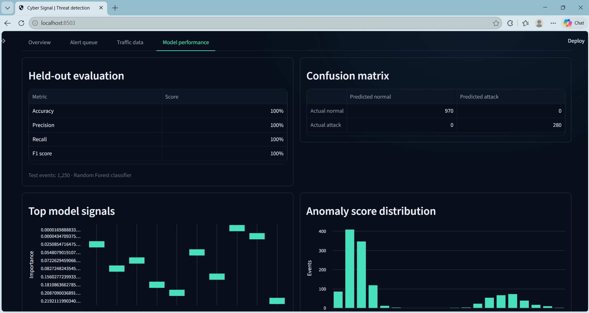

### Feature importance

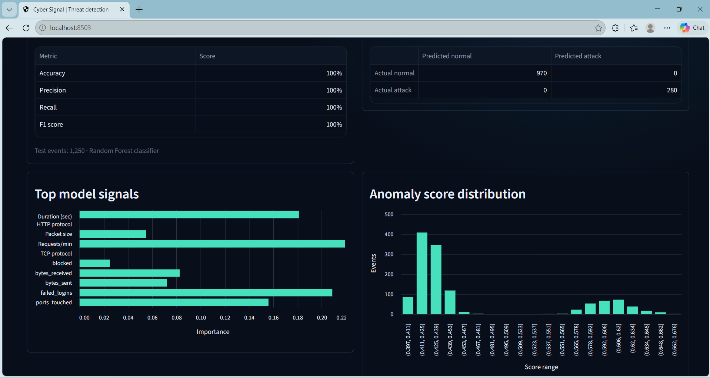

### Anomaly scores

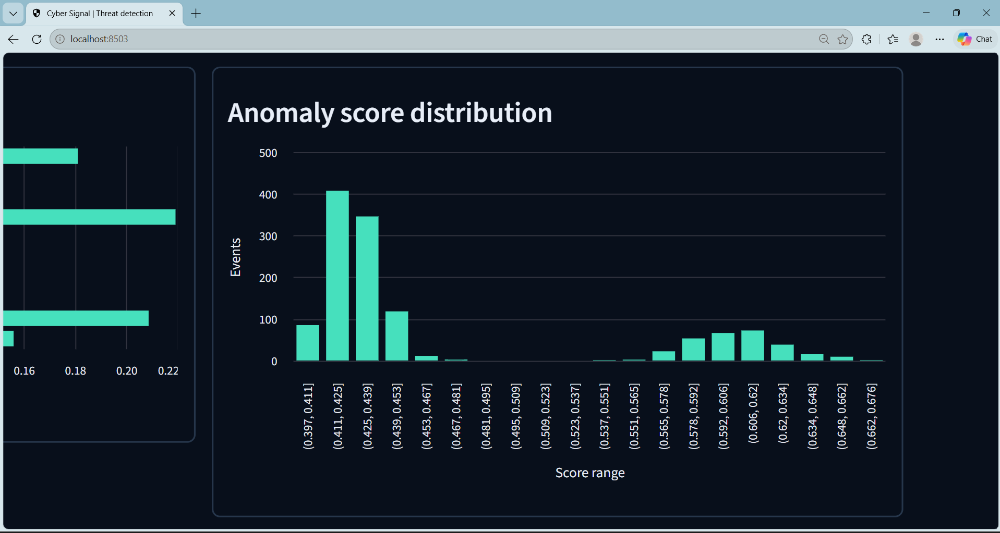

### Project UI

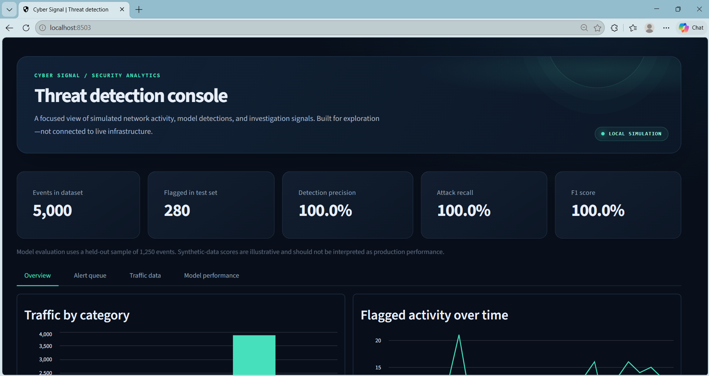

### Automated test suite

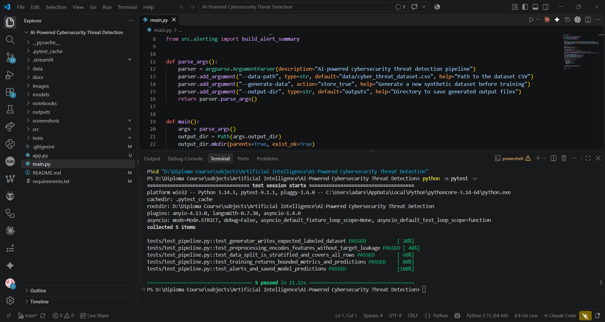

### Focused model and alert tests

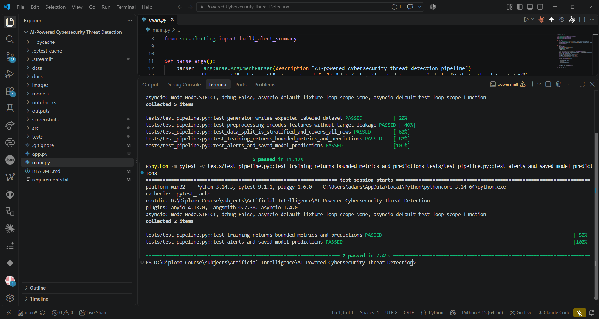

---

## 🌐 Applications & Industry Relevance

The workflow demonstrates concepts used in security analytics and SOC tooling:

- Network intrusion and suspicious traffic triage
- Anomaly screening for unusual event behavior
- Alert prioritization for analyst review
- Model evaluation and visualization
- Repeatable data and model pipelines

Banks, technology companies, and product organizations may use related techniques alongside rules, endpoint telemetry, threat intelligence, SIEM tools, and human investigation. This student project is a small offline simulation of selected concepts; it is not a deployment or representation of any named company's internal security systems.

---

## ✅ Advantages

- Runs locally with common Python libraries.
- Includes a generated dataset, so no external dataset download is required for the demo.
- Reproducible random seed for repeatable examples.
- Separates data generation, preprocessing, modeling, alerting, and visualization code.
- Shows both supervised classification and unsupervised anomaly scoring.
- Includes an interactive dashboard and CLI pipeline.
- Includes automated tests and GitHub-ready documentation.
- Does not require real corporate access, a GPU, or live network traffic.

---

## ⚠️ Limitations & Responsible Use

- All supplied events are synthetic; they are not real packet captures or validated threat intelligence.
- The labels and feature distributions are generated together, making this a demonstration rather than a realistic benchmark.
- The reported perfect metrics are not evidence of production effectiveness.
- The alert thresholds are illustrative and not calibrated for operational security decisions.
- The dashboard is local and does not ingest streaming traffic.
- No SIEM, endpoint agent, authentication, access control, cloud service, or incident-response integration is provided.
- This project is for education and defensive analysis. Do not use it to monitor systems without authorization.

---

## 🚀 Future Scope

- Evaluate against a documented public dataset such as UNSW-NB15 or CICIDS, respecting its license and format.
- Add time-aware and cross-validation evaluation.
- Report per-class metrics, ROC/PR curves, and false-positive rates.
- Improve synthetic data realism and avoid target-correlated feature leakage.
- Add model/pipeline persistence with an explicit schema and safe artifact versioning.
- Add a documented prediction interface for offline CSV uploads.
- Add explainability and analyst feedback for alert triage.
- Explore event streaming and SIEM integration only in an authorized lab.
- Add reproducible environment locking and CI test execution.

---

## 🎓 Skills Demonstrated

### Machine learning and data science

- Structured-data preparation
- Categorical feature encoding
- Stratified train/test splitting
- Random Forest classification
- Isolation Forest anomaly detection
- Evaluation metrics and confusion matrix interpretation

### Cybersecurity analytics

- Network-event field interpretation
- Attack-category simulation
- Threat confidence and alert triage concepts
- Defensive monitoring workflow awareness

### Python engineering

- Modular source structure
- CLI execution
- Pandas and NumPy data handling
- Model persistence with Joblib
- Automated testing with Pytest

### Visualization and documentation

- Interactive Streamlit dashboard
- Metric cards, tables, and charts
- GitHub README and project evidence
- Reproducible run instructions

---

## 📚 Documentation

Additional technical notes:

- [`docs/architecture.md`](docs/architecture.md) — pipeline architecture
- [`docs/github-proof-guide.md`](docs/github-proof-guide.md) — portfolio evidence tips
- [`data/README.md`](data/README.md) — generated dataset notes

---

## 🔬 Project Status

### ✅ Functional educational prototype

The local pipeline, dashboard, and automated tests have been run successfully.

- Synthetic dataset generation: implemented
- Preprocessing and feature encoding: implemented
- Random Forest classification: implemented
- Isolation Forest anomaly scoring: implemented
- Metrics, alerts, and visualizations: implemented
- Local Streamlit dashboard: implemented
- Automated tests: **5 passing**
- Live network monitoring: **not implemented**
- Production deployment or security validation: **not performed**

---

## 👨‍🎓 Author

**Adarsh Srivastav**<br>
Computer Science and Engineering (CSE) Student

**Areas of Interest:**<br>
Artificial Intelligence | Cybersecurity | Python | Machine Learning

---

## ⭐ Conclusion

The **AI-Powered Cybersecurity Threat Detection System** is a reproducible learning project showing how event data can be prepared, analyzed by classification and anomaly-detection models, converted into alerts, evaluated, and explored through a local dashboard.

It is designed to demonstrate engineering and learning—not to claim production-grade cyber defense. The next meaningful step is evaluation on a properly documented, realistic public dataset with honest reporting of limitations and errors.

---

## ⭐ Project Highlights

```text
Python
Pandas + NumPy
Scikit-learn
Random Forest
Isolation Forest
5,000 synthetic network events
Streamlit security dashboard
Threat alerts and anomaly scores
Model evaluation and visualizations
Pytest automated tests
GitHub portfolio documentation
```

**Project status: ✅ Functional local educational prototype | 🧪 5 automated tests passing | 📊 Synthetic data only**
